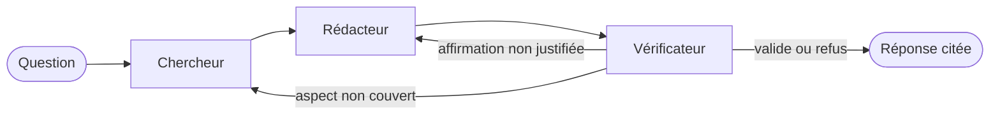

# Assistant RAG multi-agents

Assistant de questions-réponses sur des textes réglementaires européens (RGPD et AI Act).
Chaque réponse cite ses sources : document, article et page.

Deux approches sont développées et comparées sur un même jeu de questions :

- un **RAG simple** : recherche des passages pertinents, puis génération de la réponse ;
- un **système multi-agents** construit avec LangGraph : un chercheur sélectionne les passages, un rédacteur écrit la réponse, un vérificateur contrôle que chaque affirmation est soutenue par une source.

Le modèle de langage tourne en local avec Ollama : aucune donnée n'est envoyée à un service externe.

## Données

| Document | Référence | Articles | Source |
| --- | --- | --- | --- |
| RGPD | Règlement (UE) 2016/679 | 99 | [EUR-Lex](https://eur-lex.europa.eu/legal-content/FR/TXT/?uri=CELEX:32016R0679) |
| AI Act | Règlement (UE) 2024/1689 | 113 | [EUR-Lex](https://eur-lex.europa.eu/legal-content/FR/TXT/?uri=CELEX:32024R1689) |

Textes en version française. © Union européenne, https://eur-lex.europa.eu. Réutilisation autorisée avec mention de la source.

Les PDF sont lus avec PyMuPDF. Les en-têtes et pieds de page du Journal officiel sont retirés automatiquement, puis chaque règlement est découpé en articles. Chaque article conserve son numéro, son titre, son chapitre et ses pages, ce qui permet de citer les sources avec précision.

## Fonctionnement du RAG simple

1. **Découpage** : chaque article forme un chunk ; les articles de plus de 512 tokens sont redécoupés par phrases, avec un chevauchement de 64 tokens. Chaque chunk commence par le titre de son article et conserve le document, le numéro d'article et les pages.
2. **Indexation** : les chunks sont vectorisés avec le modèle d'embeddings multilingue `bge-m3`, puis l'index est sauvegardé dans `storage/`.
3. **Recherche** : les 5 chunks les plus proches de la question sont retrouvés.
4. **Génération** : `qwen3:4b-instruct` rédige la réponse à partir de ces seuls passages et cite chaque affirmation par un numéro [n]. Si les passages ne contiennent pas la réponse, le système l'indique au lieu d'inventer.

Les modèles tournent en local avec Ollama, sur processeur, sans carte graphique.

## Système multi-agents

Trois agents coopèrent dans un graphe LangGraph. Ils partagent un état commun (question, sous-questions, passages, brouillon, verdict) et chaque étape est enregistrée dans une trace consultable.



- **Chercheur** : décompose la question en sous-questions lorsqu'elle porte sur plusieurs aspects, lance une recherche pour chacune et retient les passages à tour de rôle, avec au plus 2 passages par article, pour que chaque aspect soit couvert.
- **Rédacteur** : rédige la réponse à partir des seuls passages retenus, en citant chaque affirmation, et la corrige à partir des remarques du vérificateur.
- **Vérificateur** : contrôle que chaque affirmation est justifiée par l'extrait qu'elle cite (montants, délais, conditions). Il renvoie la réponse au rédacteur si une affirmation n'est pas justifiée, ou au chercheur avec de nouvelles requêtes si un aspect n'est couvert par aucun passage. Le nombre de corrections est limité à 2.

Le système multi-agents utilise le même modèle, le même index et le même nombre maximal de passages (5) que le RAG simple, pour que la comparaison ne porte que sur l'architecture.

## Évaluation

Le système est évalué sur 60 questions écrites à partir du texte des deux règlements, chacune accompagnée d'une réponse de référence et des articles qui la justifient (`data/eval/questions.jsonl`) :

| Type | Dev | Test | Ce qui est vérifié |
| --- | --- | --- | --- |
| Factuelle | 24 | 12 | réponse contenue dans un seul article |
| Multi-articles | 8 | 4 | réponse combinant deux articles, parfois des deux règlements |
| Hors corpus | 8 | 4 | absence de réponse dans les documents : le système doit refuser |

Les réglages se font uniquement sur le jeu **dev** ; le jeu **test** est réservé à la comparaison finale.

Métriques : qualité de la recherche (Hit@k, Rappel@k, MRR), qualité des citations (précision et rappel par rapport aux articles attendus), exactitude des réponses jugée par un LLM-juge (`qwen3:8b`) puis relue à la main pour chaque réponse, taux de refus correct et de refus à tort, latence.

Les évaluations tournent sur GPU dans un notebook Kaggle (`kaggle/evaluation_kaggle.ipynb`) avec le même code que la version locale. Chaque réponse est enregistrée dès qu'elle est obtenue, ce qui permet de reprendre une évaluation interrompue.

## Résultats

### Comparaison finale sur le jeu test

Les deux systèmes sont évalués sur les 20 questions du jeu **test**, jamais utilisées pendant les réglages, avec le même code, le même modèle (`qwen3:4b-instruct`), le même index et au plus 5 passages par réponse. Chaque réponse notée a été relue à la main.

| Métrique | RAG simple | Agents |
| --- | --- | --- |
| Rappel@5 (articles attendus retrouvés) | 100 % | 100 % |
| Précision des citations | 92 % | 84 % |
| Exactitude relue, questions factuelles | 0,96 | 0,88 |
| Exactitude relue, questions multi-articles | 0,88 | 0,75 |
| Exactitude relue, ensemble | **0,94** | 0,84 |
| Refus correct (hors corpus) | 100 % | 100 % |
| Appels au LLM par question | 1 | 3,8 |
| Latence médiane sur GPU T4 | 3,4 s | 6,9 s |

Sur les 48 questions avec réponse des jeux dev et test réunis, l'écart d'exactitude (agents − simple) est de −0,02, avec un intervalle de confiance à 95 % de [−0,10 ; 0,06] obtenu par bootstrap apparié : **aucun des deux systèmes n'est significativement plus exact**. L'écart est du même ordre que la variabilité d'un même système d'une exécution à l'autre (19 réponses sur 40 changent entre deux exécutions sur GPU).

**Ce que montrent les expériences :**

- le **chercheur** améliore la couverture des questions qui combinent plusieurs articles lorsque la recherche simple en manque un (jeu dev : rappel de 81 % à 94 %) ;
- le **vérificateur**, avec un modèle de 4 milliards de paramètres, ne corrige pas les réponses de façon fiable, mais signale les réponses douteuses : sur le jeu test, 2 réponses non validées sur 3 sont fausses ou incomplètes, contre 2 sur 13 parmi les réponses validées ;
- la **décomposition** des questions provoque aussi des erreurs de synthèse lors de la rédaction.

**Choix retenu :** le RAG simple est le mode par défaut, aussi exact, deux fois plus rapide et quatre fois moins coûteux. Le mode multi-agents reste disponible pour les questions qui combinent plusieurs règles, avec un avertissement lorsque le vérificateur n'a pas validé la réponse.

Détails : `notebooks/03_evaluation_baseline.ipynb` (référence), `notebooks/04_multi_agents.ipynb` (mise au point des agents sur le jeu dev), `notebooks/05_comparaison_finale.ipynb` (jeu test) et `results/`.

### Limites

- Jeu d'évaluation réduit (48 questions avec réponse) : seuls des écarts importants sont détectables.
- Un seul modèle de génération, de petite taille, imposé par l'exécution locale sur processeur.
- Relecture humaine faite par une seule personne ; le LLM-juge n'est d'accord avec elle que dans 74 à 84 % des cas.
- Génération non déterministe sur GPU ; chaque système n'a été évalué qu'une fois sur le jeu test.
- Certaines notations sont perdues à l'extraction du PDF (exposants : 10^25 est lu « 1025 »).

## Structure du projet

```
assistant-rag-agents/
├── data/
│   ├── raw/                   Documents sources (PDF)
│   └── eval/questions.jsonl   Jeu de questions annoté
├── kaggle/
│   └── evaluation_kaggle.ipynb  Évaluation sur GPU
├── notebooks/
│   ├── 01_exploration_documents.ipynb
│   ├── 02_rag_simple.ipynb
│   ├── 03_evaluation_baseline.ipynb
│   ├── 04_multi_agents.ipynb
│   └── 05_comparaison_finale.ipynb
├── results/                   Réponses et métriques de chaque évaluation
├── scripts/
│   ├── check_documents.py     Contrôle de la présence et du découpage des documents
│   ├── build_index.py         Construction de l'index vectoriel
│   ├── ask.py                 Question en ligne de commande
│   ├── evaluate.py            Évaluation sur le jeu de questions
│   └── log_mlflow.py          Enregistrement des évaluations dans MLflow
├── src/assistant_rag/
│   ├── config.py              Chemins, corpus et paramètres
│   ├── extraction.py          Extraction du texte, nettoyage, découpage en articles
│   ├── chunking.py            Découpage des articles en chunks avec métadonnées
│   ├── indexing.py            Construction et chargement de l'index
│   ├── prompts.py             Prompts de génération
│   ├── citations.py           Lecture des citations [n]
│   ├── rag.py                 RAG simple
│   ├── agents/                Chercheur, rédacteur, vérificateur et graphe LangGraph
│   ├── evaluation/            Jeu de questions, métriques, LLM-juge, exécution
│   └── tracking.py            Suivi des expériences avec MLflow
└── tests/                     Tests unitaires (pytest)
```

## Installation

Prérequis : Python 3.11 ou plus récent et [Ollama](https://ollama.com/download).

```bash
python -m venv .venv
.venv\Scripts\activate          # Windows
source .venv/bin/activate       # Linux / macOS
pip install -r requirements-dev.txt
pip install -e .
ollama pull qwen3:4b-instruct
ollama pull bge-m3
```

## Utilisation

```bash
python scripts/check_documents.py
python scripts/build_index.py
python scripts/ask.py "Quelles sont les conditions du droit à l'effacement ?" --show-context
python scripts/ask.py "Quelles obligations en cas de violation de données ?" --system agents --show-trace
python scripts/evaluate.py --split dev --limit 3
python scripts/log_mlflow.py
mlflow ui --backend-store-uri sqlite:///mlflow.db
pytest
```

Les paramètres se modifient par variables d'environnement : `LLM_MODEL`, `EMBED_MODEL`, `JUDGE_MODEL`, `VERIFIER_MODEL`, `CHUNK_SIZE`, `CHUNK_OVERLAP`, `TOP_K`, `CONTEXT_WINDOW`, `OLLAMA_BASE_URL`.

## Stack technique

Python · PyMuPDF · pandas · LlamaIndex · LangGraph · Ollama · MLflow · FastAPI · Streamlit · Docker · GitHub Actions

## Feuille de route

- [x] Corpus, extraction du texte et découpage en articles
- [x] RAG simple avec citation des sources
- [x] Jeu de questions de test et évaluation de référence
- [x] Système multi-agents (chercheur, rédacteur, vérificateur)
- [x] Comparaison RAG simple / multi-agents
- [ ] Suivi des expériences avec MLflow
- [ ] API FastAPI et interface Streamlit
- [ ] Conteneurisation Docker et intégration continue
